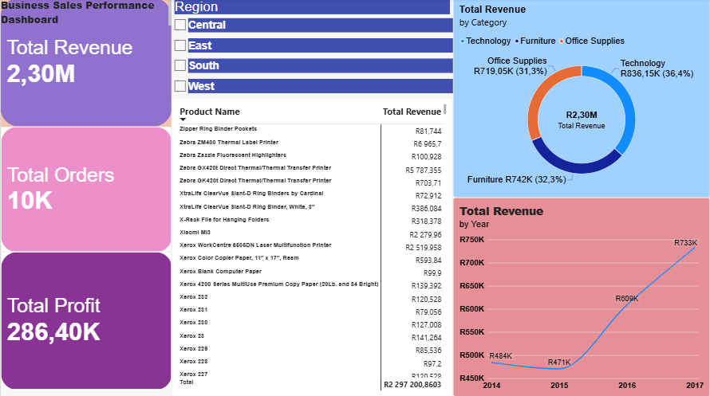

# Business Sales Performance Analytics - Task 1 
## Project Overview
This project analyzes business sales performance using Power BI to evaluate revenue trends, product rankings, high-value categories, and regional growth.

## Key Business Insights
* **Total Revenue**: R2.30M across 10k total orders with a net profit of R286.40K.
*  **Top Category**: Technology generated the highest share of revenue at 36.4% (R836.15k), followed by Furniture (32.3%) and Office Supplies (31.3%).
*  **Revenue Trend**: Annual sales showed steady upward growth, rising from R484k in 2014 to R733k in 2017.

## Tools Used 
* **Power BI Desktop**: Data cleaning, Dax measures, and visual dashboard design.
* **Dataset**: Superstore Sales Dataset.

  ## Dashboard Preview
   
